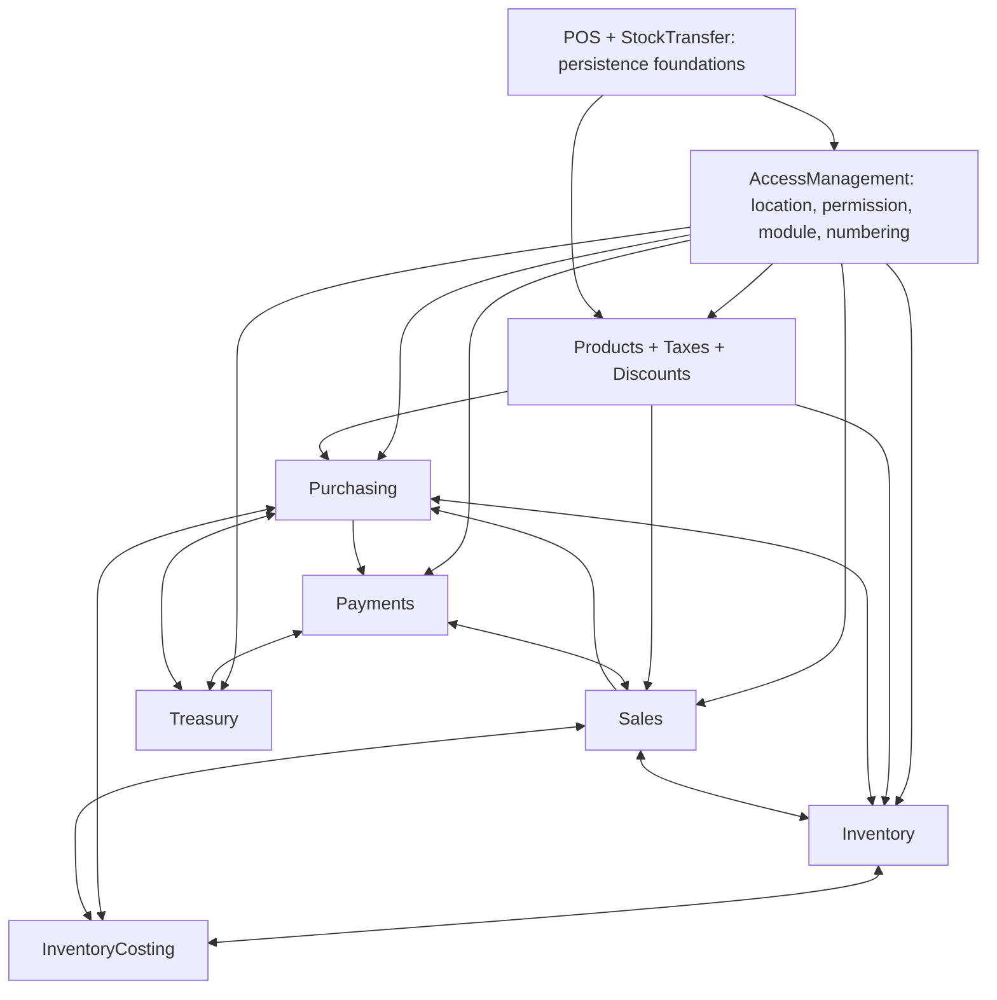

# FOX & HEMA — Engineering audit

Audit date: 2026-10-31 (Africa/Cairo). Repository: `D:\PointSale\app`.

## Executive summary

This is a static, evidence-based audit of the current working tree, including existing uncommitted changes. No earlier audit's findings or measurements were accepted as current evidence. Twelve module directories and 35 Filament resource classes were inventoried. Critical posting services, authorization helpers, models, migration definitions, resource query preparation, and representative regression tests were inspected; the depth is described below. This is not certification that every execution path is correct.

**Nine confirmed repository findings: Critical 0; High 0; Medium 7; Low 2.** Eight concern demonstrated query/locking/volume patterns; one concerns missing database reinforcement of stock invariants. These are code-level findings, not measured latency results or demonstrated production corruption. **Six suspected risks require further verification.** No reachable double-spend, oversell, or cross-branch write exploit was established in this audit.

Important safeguards exist: transaction-owned posting, current locking reads, unique operation identities, payload fingerprints, decimal arithmetic, reservation ownership, immutable document evidence, and explicit branch authorization. Several operational capabilities remain deliberately incomplete: stock-transfer posting, POS operations, valued physical adjustments, quarantine release, and standard-cost revaluation. Do not substitute generic stock movements for those workflows.

Runtime profiling, database reconciliation, deployed-schema inspection, and tests were NOT RUN. Existing test bootstraps create/drop schemas and fixtures migrate/write records, which conflicts with this task's restrictions. No verified, already populated, isolated read-only profiling target was established. No production database was queried.

## Evidence and method

Installed versions were read through Composer and Boost application information: PHP 8.5.5; Laravel 13.35.0; Filament 5.10.1; Livewire 4.4.7; Spatie Permission 8.3.0; PHPUnit 12.5.38; Debugbar 4.4.4. MySQL is the intended/tested transactional backend; server version, isolation configuration, installed indexes, and Redis availability were not independently verified.

The requested `.ai/rules` directory is absent. No additional path-scoped AGENTS.md was discovered in the inspected application/test/docs paths. Existing changes were preserved. Only the four requested reports are created. Source references below are repository-relative and line numbers refer to the audited working tree. Static reproduction scenarios describe future disposable-environment tests; they were not executed.

Definitions:
- **Confirmed:** the source demonstrably contains the described gap or query/lock pattern. Does not imply an HTTP exploit or measured user impact.
- **Suspected:** additional reachability, business-policy, deployment, or runtime evidence is required.
- **Tested in source:** regression assertions exist; their execution result in this audit is unknown.
- **Not implemented:** a missing operational capability, distinct from a defect in a supported workflow.

## Module inventory and dependency map

Counts describe files under the module's Models, Services, Policies and Database/Migrations directories; they are inventory counts, not executable coverage.

| Module | Models | Services | Resources | Policies | Migrations | Actual responsibilities and dependencies |
|---|---:|---:|---:|---:|---:|---|
| AccessManagement | 9 | 19 | 7 | 7 | 14 | Users, roles, permissions, membership, active location, modules, security events, document numbering; foundation for all business modules. |
| Products | 7 | 14 | 5 | 8 | 12 | Shared catalog, variants, unallocated identity, images, pricing, barcode; depends on AccessManagement; references Inventory, Costing, Purchasing, Sales, Taxes and Discounts. |
| Taxes | 2 | 7 | 1 | 1 | 4 | Tax definitions and product assignments; commercial line calculations and shared definition authorization used by Discounts/Products. |
| Discounts | 2 | 2 | 1 | 1 | 3 | Discount definitions/assignments; uses shared Taxes definition infrastructure and Products references. |
| Inventory | 6 | 14 | 4 | 4 | 7 | Balances, movements, size allocations, count drafts, quarantine observations, stock insights; depends on AccessManagement/Products and tightly couples posting to Costing/Purchasing/Sales. |
| InventoryCosting | 8 | 8 | 0 | 0 | 12 | Category methods, FIFO layers/consumptions, AVCO states, standard revisions, estimated COGS; uses Inventory, Products, Purchasing receipts and Sales issues/returns. Authorization comes from owning workflows; no independent resource/policy layer. |
| Purchasing | 11 | 18 | 5 | 5 | 18 | Suppliers, PO lifecycle, partial receipts, receipt-matched bills, supplier settlement; depends on Products, Inventory/Costing, Payments money/methods and Treasury. |
| Sales | 23 | 27 | 5 | 5 | 21 | Orders, reservations, partial delivery, invoices, approved returns, credits, PDFs/profitability; depends on Products, Inventory/Costing, commercial calculators in Purchasing/Taxes and Payments/Treasury settlement. |
| Payments | 6 | 14 | 5 | 5 | 8 | Foundation payments, customers, invoice ownership links, allocations, refunds/recovery, history, methods; depends on Sales and Treasury as well as AccessManagement. |
| Treasury | 3 | 8 | 2 | 2 | 7 | Cash/bank accounts, vouchers, transfer legs, reversal, ledger, numbering; depends on Payments and Purchasing for controlled settlement evidence. |
| StockTransfer | 6 | 0 | 0 | 0 | 7 | Transfer/shipment/receipt persistence and constraints only; no implemented posting orchestration, transit valuation, or user workflow found. |
| POS | 5 | 0 | 0 | 0 | 6 | Device/session/transaction/cash-movement persistence only; no checkout/closing orchestration or business resources found. |

Arrows denote source-level dependency, not an asynchronous message bus. Circular dependencies are real orchestration relationships. Sales uses Purchasing's calculator; Treasury uses payment/vendor posting boundary flags; Inventory validates concrete receipt/delivery/return types. These are maintenance coupling observations, not grounds for a large rewrite.

Registration evidence: `AccessManagement/Services/ModuleDiscovery.php:12`, `ModuleRegistry.php:21`, `app/Providers/AppServiceProvider.php:75`, and `app/Providers/Filament/AdminPanelProvider.php:116`. Registry descriptions are partly stale: `ModuleRegistry.php:43-47` describes issue valuation as absent even though StockIssueValuationService exists. Inventory follows implemented classes rather than those descriptions.

## Critical workflows and transaction boundaries

Paths in this section start under `app/Modules/`.

| Workflow | Boundary and authoritative records | Verification and limitations |
|---|---|---|
| PO confirmation → initial receipt | Purchasing/Services/PurchaseOrderService.php:212; ModuleRegistryLock → PO/items → receipt creation in the same transaction | Initial receipt preparation is repeat-safe; a receipt draft does not change stock. |
| Partial goods receipt | Purchasing/Services/PurchaseReceiptService.php:107-174 | Locks registry/PO/receipt, checks previous posted quantity, sorts variants, posts movement/balance/cost/layers and links items, updates PO and prepares backorder atomically. Positive whole pieces enforced for unallocated stock. |
| Vendor bill → payment | VendorBillService.php:85-132; VendorPaymentAllocationService.php:33-89; PurchaseSettlement.php:22 | Bills consume only posted receipt quantities. Supplier, order location, allocation budget and bill budget checked under locks. Settlement groups Treasury disbursement and allocation in outer transaction. Supplier invoice identity prevents duplicates; do not assume arbitrary bill creation submissions replay successfully. |
| Sales confirmation/reservation | Sales/Services/SalesOrderConfirmationService.php:18-53; SalesReservationService.php:27-52 | Locks registry/order/balances, validates available stock, records reservation ownership, stores confirmation fingerprint. Cancellation releases only owned unconsumed reservations. |
| Partial delivery | Sales/Services/SalesDeliveryPostingService.php:30-124 | Locks registry/order/documents and balances, verifies reservation ownership and valuation, consumes reservation and issues stock/cost under one transaction. Replay checks evidence. |
| Invoice | Sales/Services/SalesInvoiceService.php:86-138, 229-303 | Posted deliveries only; per-delivery and order-line caps; proportional four-decimal allocation with final remainder. Posting verifies saved amounts/customer/currency and snapshots. Cancellation is draft-only. |
| Return → credit | SalesReturnPostingService.php:28-68; InventoryCosting/Services/SalesReturnValuationService.php:42-190; SalesCreditNoteService.php:83-126 | Approved return quantities become claims; posting creates cost allocations, restock/custody/scrap records and invoice reconciliation atomically. Credits use posted return/invoice allocations and cumulative monetary entitlement. Credits do not independently restock goods. |
| Customer collection/allocation/refund | Payments/Services/CustomerPayments.php:25-40, 88-127; CustomerAllocations.php:18-51; CustomerRefunds.php:30-71, 171-206 | Controlled receipt links Treasury and original account/method; payment and invoice budgets use current locked rows; credit refunds may release excess allocation before refunding inside one transaction. Recovery adds compensation rather than deleting history. |
| Treasury receipt/payment/transfer/reversal | Treasury/Services/TreasuryService.php:129-192, 227-274 | Registry/operation/accounts, sorted account locks; authoritative posted-entry balance, debit/credit legs and posted status commit together. Source and operation identities constrained. Customer/vendor correction workflows protect their own evidence. |
| Size allocation | Inventory/Services/SizeAllocationService.php:78-93; InventoryCosting/Services/SizeAllocationValuationService.php:27-200 | Same-location unallocated → sized variants; locked balances/cost states; explicit quantity/value conservation; whole-piece targets and rounding rejection. |
| Physical count adjustment | Inventory/Services/InventoryAdjustmentDrafts.php:21-69 | Saves review evidence only. It does not post a valued adjustment. |
| Transfers/POS | StockTransfer and POS models/migrations | No posting workflow to verify. Never infer atomic transfer/checkout behavior from schema tests. |

The shared registry row serializes otherwise unrelated postings (F02). Sorting balances/account IDs is helpful, but removing the registry lock would require re-auditing all lock orders and nullable global permission assignments. Nested transaction results remain provisional until the outer commit. AuditLogger writes are synchronous; tested late failures intentionally roll back posting and numbering. No business queue/job orchestration was found; background retry policy must therefore be evaluated at each caller, not inferred from a queue setting.

## Inventory, costing and financial integrity assessment

- InventoryPostingService.php:48-145 sorts commands, upserts a unique variant/location balance, acquires current row locks, verifies the existing stock invariant, rejects a closing balance below reserved quantity, and uses unique idempotency/reversal identities. Existing valued stock requires an integrated valuation workflow. This supports, but does not runtime-prove, oversell resistance.
- SalesReservationService.php:178-214 checks reservation ownership against stock and preserves historical unowned holds. A hold can block sales until explicitly reconciled; this is intentional rather than an automatic release opportunity.
- ReceiptValuationService.php:79-124 reconciles opening quantity/value; FIFO validates remaining layers; AVCO adds extended receipt value and derives the average from total value; standard receipts use effective revisions and record purchase-price variance.
- StockIssueValuationService.php:63-204 validates method continuity and opening quantity; FIFO consumption checks availability; AVCO consumes proportional authoritative total value and takes the full residual on exhaustion; standard issues enforce the current carrying target. Final state is verified before commit.
- SalesReturnValuationService.php:85-190 restores original cost slices, preserves cumulative residuals and separates restock, damaged custody, scrap loss and standard-cost variance. Return budgets and credit budgets are distinct.
- SizeAllocationValuationService.php:111-200 rejects unsupported standard-cost differences and nonconserving rounding splits instead of silently changing inventory value.
- Standard-cost revision changes do not automatically revalue existing stock. Receipts/issues/allocations fail closed if the carrying target disagrees. A sanctioned revaluation workflow was not found.
- Generic reversal rejects valued stock (InventoryPostingService.php:149-159); it is not a substitute for purchase returns or cross-location valuation.
- TreasuryService.php:358-435 locks accounts in sorted order and derives balances from posted ledger entries, not a Redis balance. Customer and vendor allocation caps are checked from locked authoritative records.
- DocumentNumberService.php:43-151 uses locked sequences, a UUID registry and collision checks. Financial prefixes have explicit global scope. Uniqueness is reinforced by migration definitions; actual applied schema was not queried.
- PurchaseOrderCalculator.php:14-67 uses BigDecimal, rejects floats/excess scale, rounds extended amounts HalfUp to four decimals, and sums persisted components. SalesCreditCalculator.php:17-56 uses cumulative allocation/final residuals. No float-based posting decision was demonstrated.

Repository constraint coverage is stronger for Treasury, payment amounts, Sales matching, return claims and transfer references than for stock balance arithmetic (F01). Foreign keys and unique indexes prevent many duplicate/orphan identities; they do not establish ledger-to-balance reconciliation by themselves. No data-level reconciliation result is claimed.

## Authorization and branch isolation

Reviewed controls include SalesAccess, PurchasingAccess, InventoryAccess, ProductsAccess, Payments/CustomerAccess, TreasuryAccess, policies, resource scopes, action wrappers, persistent Livewire middleware, location-context switching, and PDF controller delegation.

- Sales writes require explicit branch ownership and permissions; normal users stay in the active assigned branch. Purchasing uses location ownership through PO relationships; receipts additionally compare receipt and PO locations.
- InventoryAccess.php:62-82 temporarily resolves posting permissions at the explicit target location and restores the team in finally. This supports authorized multi-location/background work; switching team alone does not grant membership or permission.
- TreasuryAccess.php:12-55 distinguishes VIEW_ALL_LOCATIONS from OPERATE_ALL_LOCATIONS. Central accounts use null ownership and require all-location authority for ordinary users. TreasuryWorkspace.php:60-78 hides transfer operations unless both accounts are visible, while allowing an authorized local ledger leg.
- Global Super Admin is a global, web-guard role assignment with both assignment and role location null (AccessManagement/Models/User.php:204-220). A branch role with the same name does not qualify. ModuleAccess.php:41-50 still requires active modules and mapped permission ownership. There is no unconditional Gate-wide Super Admin bypass in the inspected provider.
- RequestAuthorizationFacts caches request-local facts scoped to connection/PDO/team; writes and transaction events invalidate them (AccessManagementServiceProvider.php:50-58). Tests explicitly cover grant/revoke, team switches, rollback and real Livewire requests. Cross-process changes during an already-running read request and Redis failure remain unverified.
- PDF routes require authentication/account security and initialize location context before service authorization. No separate public posting API was found in the inspected routes.

No confirmed cross-branch web exploit is reported. Read-service trust in supplied models and low-level valued receipt primitives warrant verification (R01/R02); arbitrary server-side PHP execution is not treated as an ordinary user's capability.

## Confirmed findings

### F01 — Stock balance arithmetic has no database constraint

**Module:** Inventory. **Severity:** Medium. **Category:** integrity / defense in depth. **Evidence:** app/Modules/Inventory/Database/Migrations/2026_10_09_000015_create_stock_balances_table.php:11-21 defines signed decimal on-hand/reserved/available columns with uniqueness but no arithmetic CHECK. Repository-wide stock_balances migration/ALTER search found no later invariant constraint. app/Modules/Inventory/Models/StockBalance.php:16-22 allows ordinary fill/save of all three quantities without a posting boundary.

**Reproduction:** In a future disposable schema built from these migrations, use a trusted direct ORM write to set on-hand=1, reserved=2, available=-1, or available=99. The repository defines no constraint rejecting those values. This was not executed; it is not a demonstrated end-user exploit. InventoryPostingTest.php:125-154 itself creates invalid balances to verify that subsequent posting rejects them, which corroborates the intended current application-only boundary.

**Impact:** Future imports, maintenance code or bypassing callers can persist inconsistent stock; normal posting then fails closed, interrupting sales/receiving. **Likelihood:** medium for maintenance/import mistakes. **Confidence:** high for repository gap, unverified for deployed schema. **Fix:** after reconciliation, constrain nonnegative on-hand/reserved and available=on-hand-reserved with reserved<=on-hand; consider a controlled mutation boundary. Do not derive on-hand from a cache. **Complexity:** medium. **Required tests:** MySQL direct-write constraint rejection, valid reservation/issue transitions, legacy-invalid-row handling, rollback. **Dependencies:** inspect actual schema/data safely first; no migration is authorized by this audit.

### F02 — One global row serializes postings across branches

**Module:** shared AccessManagement / all posting modules. **Severity:** Medium. **Category:** concurrency / performance. **Evidence:** app/Modules/AccessManagement/Services/ModuleRegistryLock.php:10-12 exclusively locks the same access_management row. It is acquired inside InventoryPostingService.php:70-71, TreasuryService.php:131-132, SalesDeliveryPostingService.php:32-33 and PurchaseReceiptService.php:235-240, and held until the outer transaction ends.

**Reproduction:** On two disposable MySQL connections, start unrelated branch-A receipt and branch-B Treasury posting; pause A after acquiring the registry row. B waits despite disjoint business records. **Impact:** unrelated cash/stock operations queue behind the slowest posting. This protects authorization and helps ordering; it is not a deadlock defect by itself. **Likelihood:** high under overlap. **Confidence:** high for serialization; latency not measured. **Fix:** first shorten work inside transactions, then evaluate shared authorization/version checks and narrowly scoped business locks while preserving revocation consistency. **Complexity:** high. **Tests:** multi-branch overlap, grant/revoke/deactivation races, opposite lock orders, rollback and replay on real connections. **Dependencies:** F03/F09 optimization and an explicit authorization-lock design; do not simply delete the lock.

### F03 — Every Treasury balance check materializes the account's entire ledger

**Module:** Treasury. **Severity:** Medium. **Category:** performance / lock duration. **Evidence:** app/Modules/Treasury/Services/TreasuryService.php:420-435 selects all posted entry amounts/directions, optionally FOR UPDATE, calls get(), and sums in PHP. post():167-168 invokes it for each planned account leg.

**Reproduction:** Post a withdrawal for an account with a long retained ledger; compare rows read/locked and PHP memory at 100 vs 100,000 entries in an authorized future fixture. **Impact:** posting cost grows with lifetime ledger history, amplifying F02 and selector cost. **Likelihood:** high as history grows. **Confidence:** high for unbounded reads; no measured timing. **Fix:** retain account locking and current-read semantics; evaluate exact SQL aggregation or a separately reconciled ledger projection. A naive repeatable-read SUM may return a stale snapshot; preserve the current-read guarantee. **Complexity:** medium/high. **Tests:** old-snapshot withdrawal, concurrent withdrawals/transfers/reversals, exact decimals, row/memory growth. **Dependencies:** shared baseline and TreasuryConcurrencyTest contracts.

### F04 — Credit-note detail callbacks issue two aggregate queries per allocation

**Module:** Sales. **Severity:** Medium. **Category:** N+1 / form rendering. **Evidence:** app/Modules/Sales/Services/SalesCreditNoteService.php:179-197 iterates rows and executes sums at :186-187 and :192-193. SalesCreditNoteForm.php:38,53,76,82,110,123 calls details repeatedly, including within line callbacks.

**Reproduction:** Open/populate a credit form for N eligible return allocations, then add repeaters/change quantities. One details call performs 2N aggregate queries beyond its base/auth reads; callback repetition can multiply the scan. **Impact:** slow interactive form with larger returns. **Likelihood:** high on larger documents. **Confidence:** high, static. **Fix:** group posted usage by allocation and invoice-item IDs and reuse scalar results only within an authorized render boundary; invalidate after writes. **Complexity:** medium. **Tests:** actual Livewire create/edit at 1/20/100 allocations, partial credits, residual equality, branch/cost isolation and permission revocation. **Dependencies:** none; preserve source authorization.

### F05 — Vendor-bill prefill queries receipt usage per row

**Module:** Purchasing. **Severity:** Medium. **Category:** N+1. **Evidence:** app/Modules/Purchasing/Services/VendorBillService.php:163-172 calls remaining() per receipt line; :185-193 loads posted matches separately. :196-199 eager-loads variant.product but not variant.color/size; ProductVariant.php:49-70 displayName() accesses those relationships. Entry points: VendorBillForm.php:53 and Pages/CreateVendorBill.php:36.

**Reproduction:** Prefill a bill from N posted receipt lines with distinct size/color variants. Usage reads grow by N; unloaded size/color adds up to two queries per distinct variant instance. **Impact:** unnecessary latency and model hydration before invoice review. **Likelihood:** high for larger receipts. **Confidence:** high for per-row usage; relation counts depend on null/shared attributes. **Fix:** grouped matched-quantity sums limited to authorized source receipts; eager-load only product/color/size needed for labels. **Complexity:** medium. **Tests:** 1/20/100 lines, partial bill/receipt matching, multiple receipts, exact remaining quantities and foreign source rejection. **Dependencies:** none.

### F06 — Vendor-bill revision fingerprints query matches per line

**Module:** Purchasing. **Severity:** Low. **Category:** N+1 / maintainability. **Evidence:** app/Modules/Purchasing/Services/VendorBillService.php:146-150 loads items then explicitly queries receiptMatches() inside map. EditVendorBill.php:26,39 and VendorBillsTable.php:47 invoke revision checks.

**Reproduction:** Edit or post a bill with N lines. One revision calculation executes one item query plus N match queries; it can be called repeatedly during a mutation. **Impact:** slower edit/post while retaining correct stale-form detection. **Likelihood:** high for multiline bills. **Confidence:** high. **Fix:** ordered eager loading of matches and serialize the loaded collection in exactly the existing fingerprint order. **Complexity:** low/medium. **Tests:** identical legacy revision hashes, changed-match rejection, stale revisions and bounded query growth. **Dependencies:** none; changing fingerprint serialization would require compatibility handling.

### F07 — Supplier payment account options calculate balances per account

**Module:** Purchasing / Treasury. **Severity:** Medium. **Category:** N+1 / form performance. **Evidence:** app/Modules/Purchasing/Filament/Resources/VendorPayments/VendorPaymentResource.php:98-130 loops visible accounts and at :116 invokes TreasuryService::balance(); TreasuryService.php:277-282 rereads each account and :420-435 loads its full ledger. sourceOptions is used at VendorPaymentResource.php:87.

**Reproduction:** Render/change payment method with A eligible authorized accounts and nonempty ledgers. At least A account rereads plus A ledger reads occur beyond initial option/method/access queries. **Impact:** repeated form refresh latency scales with both account count and retained ledger. **Likelihood:** medium; strongest for all-location finance users. **Confidence:** high, static. **Fix:** authorize account visibility and balance disclosure separately, then compute grouped balances once for eligible IDs; reuse TreasuryWorkspace's aggregate pattern without widening permissions. **Complexity:** medium. **Tests:** 1/20/100 account scaling, view-vs-balance-vs-operate permissions, cash/bank filtering, central/branch accounts, permission revocation. **Dependencies:** preserve F03 posting semantics; do not replace posting balance decisions with UI values.

### F08 — Financial selectors load unbounded option lists

**Module:** Payments / Purchasing. **Severity:** Low. **Category:** volume / memory. **Evidence:** app/Modules/Payments/Filament/Resources/CustomerRefunds/CustomerRefundResource.php:62 plucks every visible posted payment; VendorPaymentResource.php:75 plucks every active supplier. CustomerPaymentResource.php:74-82 also defines an unbounded customer options helper, though canCreate():59-62 is false, so that generic create path is not assumed reachable.

**Reproduction:** Open the registered refund-create form or supplier-payment form with thousands of eligible records. searchable() filters an already-loaded options list; these closures do not implement server-side bounded search. **Impact:** growing response payload/browser and PHP memory. **Likelihood:** medium over time. **Confidence:** high for active refund/supplier selectors. **Fix:** bounded server search and explicit selected-record label hydration, preserving visibility and eligibility. **Complexity:** low/medium. **Tests:** limit, search semantics, chosen historical labels, unauthorized UUID/ID submission, initial and subsequent Livewire requests. **Dependencies:** none.

### F09 — FIFO validation traverses provenance lazily for each layer under posting locks

**Module:** InventoryCosting / Sales. **Severity:** Medium. **Category:** N+1 / critical-section performance. **Evidence:** app/Modules/InventoryCosting/Services/StockIssueValuationService.php:107-112 and :231-234 retrieve layers without eager loading stockMovement. assertLayers():245-259 accesses layer->stockMovement and invokes provenance on positive layers. receiptProvenance():278-290 traverses sourceLayer, movement, purchaseReceiptItem.purchaseReceipt and inventoryCostEntry. Returned-layer provenance also performs finds at :310-312.

**Reproduction:** Deliver a variant with L retained FIFO layers, P positive root layers and lineage depth D. Layer validation adds relationship reads per layer/root and per ancestor; verification can run multiple times in the same posting. **Impact:** longer posting locks and branch-wide blocking through F02. **Likelihood:** high as FIFO history accumulates. **Confidence:** high for lazy traversal, exact counts unmeasured. **Fix:** batch required movement/receipt/entry relationships and iteratively batch ancestor IDs with cycle detection. Separate active-consumption selection from historical reconciliation only with equivalent evidence guarantees; never remove provenance checks merely for speed. **Complexity:** medium/high. **Tests:** query scaling by retained/active/ancestry counts, exact return layers, size-allocation ancestry, corrupted lineage rejection, FIFO residuals, rollback and concurrent replay. **Dependencies:** retained evidence and locking behavior must remain intact.

## Highest-priority confirmed findings

Only nine were established; no tenth was invented.

| Rank | ID | Severity | Reason |
|---:|---|---|---|
| 1 | F01 | Medium | Prevent invalid stock persistence outside supported posting paths. |
| 2 | F09 | Medium | FIFO history work increases critical transaction duration. |
| 3 | F03 | Medium | Lifetime ledger scans affect every cash posting. |
| 4 | F02 | Medium | Shared lock spreads those costs across branches; redesign only after reducing work. |
| 5 | F07 | Medium | Financial account options multiply ledger scans. |
| 6 | F04 | Medium | Repeated credit form aggregates multiply with document size. |
| 7 | F05 | Medium | Receipt-based bill preparation queries per line. |
| 8 | F06 | Low | Revision N+1 has a small, compatibility-sensitive fix. |
| 9 | F08 | Low | Unbounded selectors grow with transaction history. |

## Suspected risks requiring verification — six, not counted as confirmed findings

| ID | Evidence / scenario | Potential impact and confidence | Required verification / response |
|---|---|---|---|
| R01 | Payments/Services/CustomerFinancials.php:21-30 uses supplied payment location/status/amount; customer():55-61 uses supplied customer ownership. invoice():35 instead reloads its header. | Stale/altered model ownership or values could mislead read calculations if an untrusted caller can supply them. Medium confidence in trust-boundary concern; no demonstrated web bypass. | Trace all callers and Livewire model hydration; future direct-service tests with forged foreign ownership and stale headers. Reload authorized persisted identities if the boundary is public. Posting callers already reload/lock records. |
| R02 | Inventory/Services/InventoryPostingService.php:205-239 permits receipt valuation commands based on type/reference, transaction and permissions; unlike Sales issues/returns, it lacks exact authorized-command identity. | A future/untrusted direct caller could supply mismatched receipt quantity/location/cost without invoking ReceiptValuationService. Medium confidence; current web input does not expose StockPostingCommand construction. | Attempt forged receipt commands in disposable tests; establish supported public vs internal API and enforce document ownership/valuation orchestration before exposing this primitive. |
| R03 | Payments/Services/PaymentService.php:106-145 reverses foundation payments without compensating Treasury; TreasuryFoundationTest.php:452 explicitly demonstrates a separate Treasury-only correction. | Optional foundation-adoption records may diverge if staff expect a single reversal to correct both ledgers. High confidence in separation, policy-dependent financial risk. | Confirm intended reconciliation policy and UI reachability; test adopt → foundation reversal and adopt → Treasury reversal. Do not label intentional separate ledgers as a confirmed loss defect. |
| R04 | Repository migrations were inspected, deployed constraints/indexes/triggers were not queried. | Missing/partially applied DDL could invalidate uniqueness/immutability assumptions. Unknown likelihood; no evidence of an actual missing deployed migration. | On an explicitly authorized nonproduction copy, compare information_schema with migration expectations and duplicate/orphan checks before remediation. |
| R05 | F02/F03/F09 establish contention mechanisms, not real wait durations. | Lock timeouts, long queues, retry exhaustion under mixed branch workloads; likelihood/load threshold unknown. | Measure realistic mixed connections, lock waits, deadlocks and whole-transaction retries without weakening authorization locks. |
| R06 | Sales/Services/ProfitabilityReport.php:47-58 computes previous credits by earlier document-number ID; multiple current-note slices for the same return item share that previous quantity. | Four-decimal revenue allocation across same-note slices may differ from cumulative credit entitlements. Medium/low confidence; not reproduced. | Test one return item mapped to multiple invoice matches, partial same-note credits, fractional residuals and later credits; compare event sums with source net revenue and credit calculator. |

Operational limitations are separate: no interbranch transfer costing workflow, POS posting/close, valued adjustment post, quarantine release, or stock revaluation orchestration was established. Their absence requires scope/business design, not an emergency patch to generic movement code.

## Code quality and maintainability

Document services generally centralize mutation and deny protected fields; invoice/credit/return evidence models reject ordinary mutations. StockBalance is a notable weaker boundary (F01). TreasuryService and StockIssueValuationService are large and cross-module, but extraction should target demonstrated repeated reads (F03/F09), not a new architecture. Query-builder writes deliberately bypass model guards in trusted transaction primitives; no ordinary user's direct query-builder access is assumed. Product image observers enqueue durable cleanup tasks; ProductImageManager.php:120-127 schedules immediate cleanup after commit, with retry tracking at :130-167. File deletion is not asserted to occur before commit. These catalog side effects are not reported as a financial defect.

Request-level memoization is substantially more conservative than cross-request Redis authorization caching. Module metadata descriptions and the unused empty LocalDatabaseSafety class are maintenance observations only; no critical caller depends on the empty class in the searched source. Financial numbering's collision checks query multiple indexed tables per allocation; optimize only after measurement.

## Verification status and preservation

No tests, migrations, seeders, resets, data creation, source fixes, configuration changes, Redis changes, production/VPS access, commits, pushes or deployment were performed. Composer/package inspection and source reads were used. The four report paths are the only intended additions. A SHA-256 aggregate of application/configuration/routes/tests/database/resources/language files and dependency/test manifests was captured immediately before report creation for comparison after writing; it does not imply a clean Git tree.

Post-write verification: the aggregate source fingerprint remained unchanged: `4CE312A6D94A06470FA7B55A142E0DED5D3E3E51070754F3ECABE0B37A5B236F`. Git status comparison showed exactly the four requested audit files added and no removed or changed baseline status entries. Report existence, finding counts and module table structure were checked without running application tests.

See FOX_HEMA_PERFORMANCE_AUDIT.md for the complete resource triage matrix, static cost estimates, index hypotheses, Redis design candidates and measurement plan; FOX_HEMA_TEST_COVERAGE_MATRIX.md for named test evidence; FOX_HEMA_REMEDIATION_ROADMAP.md for implementation dependencies.
